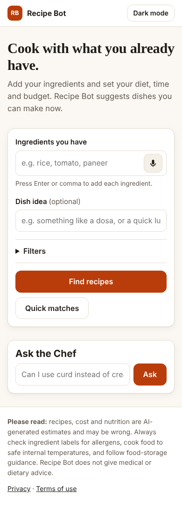
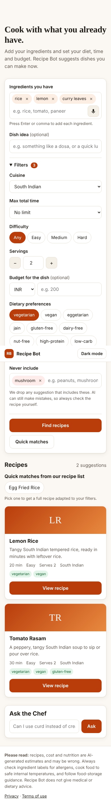
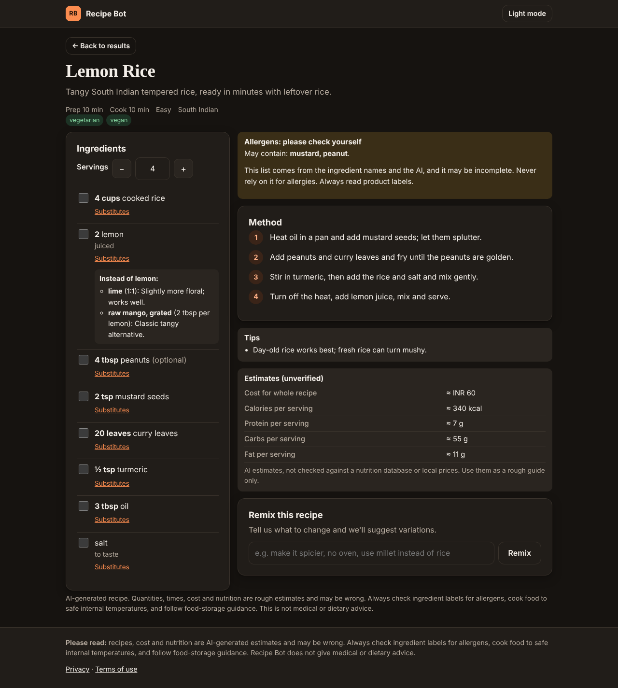
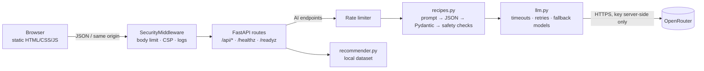

# Recipe Bot

Recipe Bot suggests recipes from the ingredients you already have. You can filter by cuisine (including South Indian, North Indian and other regional styles), diet, cooking time, difficulty, servings and budget.

> **Status:** the core recipe flow works and has tests (Stages 0–1). Accounts, saved recipes, pantry and meal planning come next (see [Roadmap](#roadmap)). **Not yet deployed:** there is no public demo URL yet.

| Home (mobile) | Results (mobile) | Recipe detail (desktop, dark) |
|---|---|---|
|  |  |  |

*Screenshots use the built-in fake AI provider (`scripts/run_mock_server.py`), so the recipes shown are sample data.*

## Features

**Available now**

- Ingredient input with removable chips, suggestions and optional voice entry
- Filters: cuisine, dietary preferences (vegetarian, vegan, eggetarian, Jain, gluten-free, dairy-free, nut-free, …), max time, difficulty, servings, budget and currency, plus a "never include" list
- 1–4 AI recipe suggestions. Each comes as structured data: ingredients with quantities and units, prep/cook times, numbered steps, tags, tips
- Server-side safety checks: recipes that contain excluded ingredients or clearly break a chosen diet are dropped before you see them
- Recipe detail with **serving scaling**, an ingredient checklist, **substitutions** for any ingredient, and **Remix** ("make it spicier", "no oven")
- Possible-allergen hints, always labelled as incomplete. Cost and nutrition are shown only as **unverified estimates**
- Instant "quick matches" from a local recipe list (no AI needed)
- Ask the Chef: short cooking Q&A
- Mobile-first, keyboard accessible, light/dark themes, loading skeletons, empty and error states with retry
- Privacy notice and terms of use pages

## Architecture



| Path | Purpose |
|---|---|
| `app/config.py` | Settings from environment variables |
| `app/schemas.py` | Request and AI-output models (validation) |
| `app/llm.py` | OpenRouter client and error mapping |
| `app/recipes.py` | Prompts, validation, diet/exclusion/allergen rules |
| `app/recommender.py` | Ingredient matcher over `data/recipes.csv` |
| `app/security.py` | Middleware, structured logging, rate limiter |
| `app/main.py` | App factory and routes |
| `static/` | Frontend |
| `tests/` | Test suite and a fake OpenRouter transport |

### API

| Method | Path | Notes |
|---|---|---|
| `POST` | `/api/recipes/generate` | Structured recipes. Rate limited |
| `POST` | `/api/recipes/substitute` | Ingredient substitutes. Rate limited |
| `POST` | `/api/ask` | Ask the Chef. Rate limited |
| `GET` | `/api/suggest?ingredients=&diets=&exclude=` | Local quick matches |
| `GET` | `/api/options` | Cuisines, diets, whether AI is configured |
| `GET` | `/healthz`, `/readyz` | Liveness and readiness |
| `GET`/`POST` | `/suggest`, `/generate`, `/ask` | Legacy endpoints from v0.1, kept for compatibility |

Interactive docs are at `/docs` (disabled when `APP_ENV=production`).

## Local setup

**Prerequisites:** Python 3.11+ and an [OpenRouter](https://openrouter.ai) API key. The key is optional if you only want to try the UI with the fake provider.

```bash
git clone https://github.com/DeepikaKrrishna/Recepie_Bot.git
cd Recepie_Bot
python -m venv .venv && source .venv/bin/activate   # Windows: .venv\Scripts\activate
pip install -r requirements-dev.txt
cp .env.example .env        # then edit .env and set OPENROUTER_API_KEY
uvicorn main:app --reload   # http://127.0.0.1:8000
```

To try it **without an API key**, using canned sample data:

```bash
python scripts/run_mock_server.py
```

To check that your key and model work (the key is never printed):

```bash
python scripts/check_openrouter.py            # pings the configured model(s)
python scripts/check_openrouter.py --list-free
```

### Environment variables

All variables are documented in [`.env.example`](.env.example). Never commit a real `.env`.

| Variable | Default | Description |
|---|---|---|
| `OPENROUTER_API_KEY` | *(empty)* | **Secret.** Server-side only. Without it, AI features are disabled and quick matches still work |
| `OPENROUTER_MODEL` | `google/gemma-3-4b-it:free` | Primary model. Free models change often, so check [openrouter.ai/models](https://openrouter.ai/models) |
| `OPENROUTER_FALLBACK_MODELS` | *(empty)* | Comma-separated models tried if the primary is unavailable |
| `OPENROUTER_TIMEOUT_SECONDS` | `45` | Per-request provider timeout (5–120) |
| `OPENROUTER_MAX_RETRIES` | `2` | Retries for timeouts, 429 and 5xx (0–4) |
| `APP_ENV` | `development` | `production` enables HSTS and hides `/docs` |
| `ALLOWED_ORIGINS` | *(empty)* | CORS origins. Leave empty when the app serves its own frontend |
| `TRUST_PROXY` | `false` | Use `X-Forwarded-For` for client IPs. Set to `true` only behind a trusted proxy |
| `AI_RATE_LIMIT_PER_MINUTE` | `8` | Per-IP limit shared by AI endpoints |
| `MAX_REQUEST_BYTES` | `16384` | Maximum request body size |
| `DEFAULT_CURRENCY` | `INR` | Default currency for budgets and estimates |
| `APP_PUBLIC_URL`, `APP_TITLE` | | Attribution headers sent to OpenRouter |
| `LOG_LEVEL` | `INFO` | |

### Database migrations

There's no database yet: Stage 1 is stateless. Stage 2 adds SQLAlchemy + Alembic (SQLite locally, PostgreSQL in production) with `alembic upgrade head`. This section will be updated when that ships.

## Tests and code quality

```bash
pytest                 # 90 tests; the AI provider is mocked and network access is blocked
ruff check . && ruff format --check .
pip-audit -r requirements.txt
```

The tests cover validation and malformed model output, retries, timeouts, fallbacks, rate limiting, body limits, security headers, CORS, diet and exclusion rules, legacy endpoints, and a guard against committed API keys. CI (`.github/workflows/ci.yml`) runs all of these on Python 3.11 and 3.13 for every push and pull request.

## Deployment (Render example)

`render.yaml` is a [Render Blueprint](https://render.com/docs/blueprint-spec). It defines a Python web service that deploys from `main` **only after GitHub checks pass** (`autoDeployTrigger: checksPass`), with `/healthz` as the health check. Other hosts can use the `Procfile`.

1. Revoke any previously exposed key and create a new one (see [Security](#security-and-privacy)).
2. On Render: **New → Blueprint**, then select the repository.
3. When prompted, set `OPENROUTER_API_KEY` (and optionally `APP_PUBLIC_URL`, `OPENROUTER_FALLBACK_MODELS`). Secrets live only in Render's environment settings.
4. Render provides HTTPS automatically. `APP_ENV=production` adds HSTS.
5. Check `https://<your-app>/readyz`. It should return `{"status": "ready"}`.

**Logs:** JSON lines on stdout. They include request id, path, status and latency, and never prompts or keys. View them in the Render dashboard.
**Rollback:** in Render, open **Events**, pick the last good deploy and choose **Rollback**. Or `git revert` the bad commit on `main` and let CI redeploy.
**Backups:** not needed until Stage 2 adds PostgreSQL. Then use a paid Render Postgres plan with point-in-time recovery, and test a restore before launch.

## Security and privacy

- The OpenRouter key stays on the server. It's never sent to the browser, logged, or included in error messages.
- All input is validated server-side, with length limits, enums and a body-size cap. AI endpoints are rate limited.
- AI output is parsed as JSON, validated, filtered against your exclusions and diet, and rendered as plain text, so it can't inject HTML or scripts. A strict Content-Security-Policy is applied.
- **Earlier versions of this repository committed OpenRouter API keys.** Those keys must be revoked. See [`docs/AUDIT.md` §7](docs/AUDIT.md#7-credential-remediation-action-required-by-the-repo-owner).
- Food safety: AI recipes, allergen hints, cost and nutrition can be wrong. Always check product labels for allergens, cook to safe internal temperatures and follow food-storage guidance. Recipe Bot never claims a recipe is allergen-free and is not medical or dietary advice.

## Known limitations

- Not yet tested against the live OpenRouter API in this pass. No valid key was available, and the leaked ones must not be used. All AI behaviour is verified with a mocked provider.
- Diet and exclusion checks use keywords. They catch obvious violations (such as chicken in a vegetarian recipe) but not hidden ingredients in branded products.
- Cost and nutrition are AI estimates with no external data source.
- Rate limiting is in-memory (one instance). Use a shared store before scaling out.
- The local quick-match dataset has 20 mostly Western recipes.
- Voice input depends on browser support (Chrome, Edge, Safari).
- No accounts, saved recipes, pantry or meal planner yet.

## Roadmap

See the prioritised backlog in [`docs/AUDIT.md`](docs/AUDIT.md#8-prioritised-backlog). Next up: **Stage 2, accounts and persistence** (saved recipes, favorites, preferences), then Smart Pantry → Food Waste Reducer → Meal Planner.

## License

No license has been chosen yet. Until the repository owner adds one, all rights are reserved by default.
