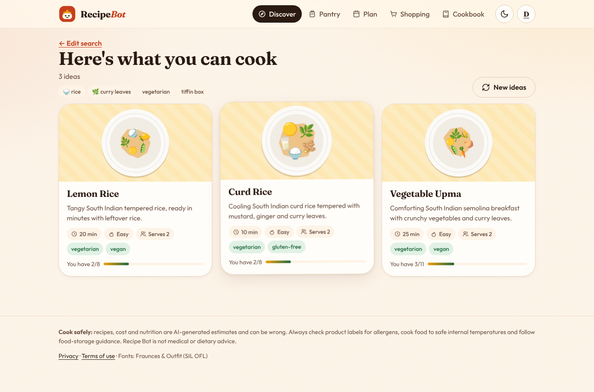
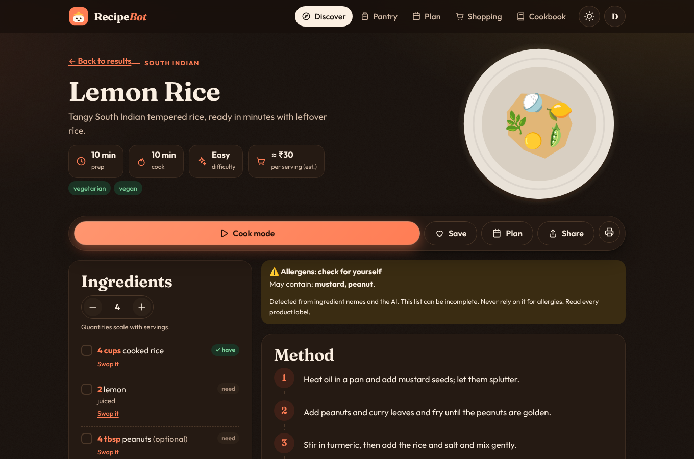
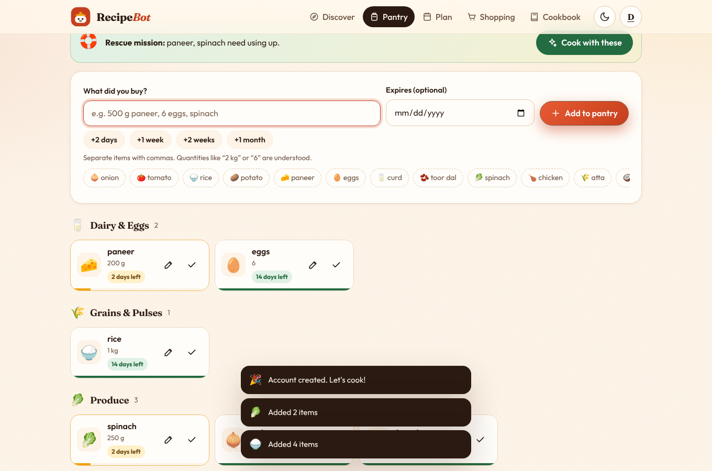
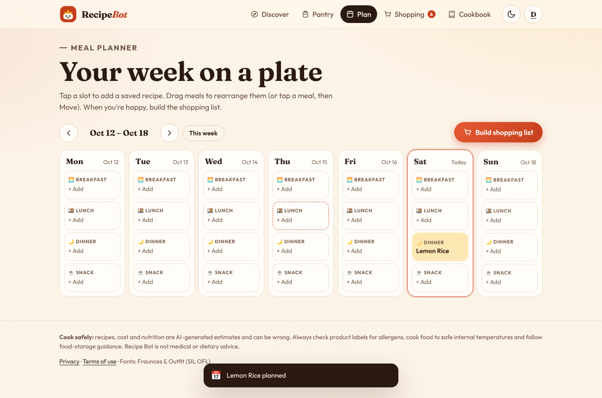
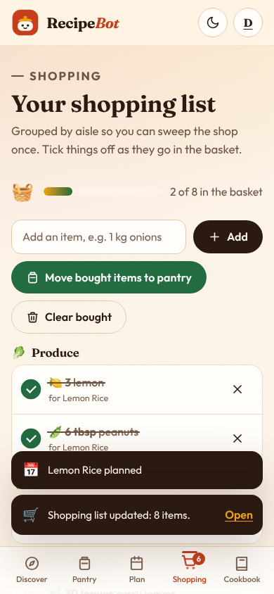
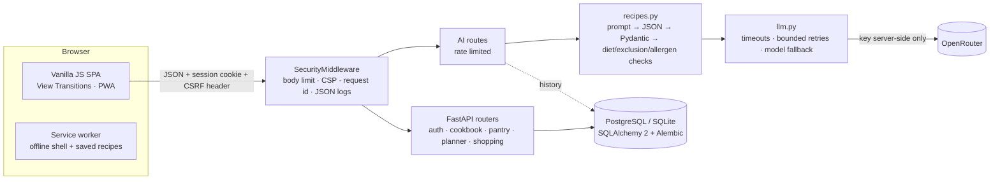

# Recipe Bot 🍲

**Cook with what you've got.** Recipe Bot turns the ingredients in your kitchen into recipes that fit your diet, time and budget. It also rescues food before it expires, walks you through cooking hands-free, plans your week and writes your shopping list.

> **Status:** feature-complete MVP. 164 backend tests pass on SQLite and PostgreSQL 16, browser journeys pass on mobile and desktop, and axe-core finds 0 accessibility violations. **Not yet deployed** (no public demo URL), and **not yet tested against the live OpenRouter API** (see [Known limitations](#known-limitations)).

| Discover → results | Recipe page (dark) | Cook Mode (mobile) |
|---|---|---|
|  |  |  |
| **Smart Pantry** | **Meal planner** | **Shopping list (mobile)** |
|  |  |  |

*Screenshots use the built-in fake AI provider (`scripts/run_mock_server.py`), so the recipes are sample data.*

## What makes it different

| Feature | What it does |
|---|---|
| 🛟 **Food-waste rescue** | The pantry tracks expiry dates with freshness bars. One tap generates recipes built around what's about to spoil and ranks the ones that use the most of it. Finish cooking, tick what you used up, and it counts towards your "items rescued" total. |
| 👩‍🍳 **Hands-free Cook Mode** | A full-screen, one-step-at-a-time view with big type. Move between steps by swiping, with the arrow keys, or by voice ("next", "back", "repeat", "timer"). It can read steps aloud, keeps the screen awake, and picks timers out of the step text ("simmer 10 minutes" → ⏱). It ends with a spice-confetti finish. |
| 🧺 **Pantry-aware recipes** | Each recipe card shows "You have 6/8". Every ingredient gets a *have* or *need* badge, and one tap adds the missing ones to your shopping list. |
| 📅 **Plan → shop** | Drag meals around a weekly grid (or tap to move on touch). One button builds a shopping list grouped by aisle: it scales by servings, merges duplicates, skips what's already in your pantry, and moves bought items back into the pantry. |
| 🪔 **Indian kitchens first** | South Indian, North Indian, Chettinad, Kerala, Hyderabadi and other regional styles; Jain and eggetarian diets; moods like "tiffin box" and "rainy-day snack"; spice levels; budgets in INR by default. |
| 🔗 **Share & remix** | Share any saved recipe with an opt-in link (your notes and email stay private). You can remix a recipe ("no onion-garlic", "air-fryer version") or swap any ingredient. |
| 📲 **Installable app** | It installs from the browser (PWA) and works offline for recently opened saved recipes. It has light and "night kitchen" dark themes. |

Plus: serving scaling with friendly fractions, favourites and notes, cook counts, search history with retention you control, data export, print-friendly recipes, voice input for ingredients, and generated "plate" artwork for every recipe.

## Safety by design

- AI output is **parsed as JSON and validated** server-side. Malformed responses are retried once, and anything that still fails is rejected, never shown.
- Recipes containing an **excluded ingredient** or clearly breaking a **chosen diet** are dropped before you see them.
- Allergens are **detected from ingredient names** and always shown as "may contain, check labels". The app never claims a recipe is allergen-free.
- Cost and nutrition are always labelled **unverified AI estimates**.
- Every page carries food-safety guidance. Recipe Bot is not medical or dietary advice.

## Architecture



| Path | Purpose |
|---|---|
| `app/main.py` | App factory, AI routes, app-shell routing |
| `app/routers/` | `account` (auth, preferences, history, export, delete), `cookbook` (+ share links), `pantry`, `planner` (+ shopping list) |
| `app/auth.py` | argon2id hashing, hashed server-side sessions, CSRF, Origin check |
| `app/models.py`, `migrations/` | Database models and Alembic migrations |
| `app/recipes.py`, `app/llm.py`, `app/schemas.py` | AI generation, validation and safety rules |
| `app/kitchen.py` | Ingredient matching, aisle categories, quantity consolidation |
| `app/security.py` | Middleware, structured logging, rate limiter |
| `static/` | Frontend (no build step): `js/views/*` pages, `js/lib/*` helpers, `css/`, fonts, PWA files |
| `tests/` | pytest suite with a fake OpenRouter transport |
| `e2e/` | Playwright journeys and axe-core accessibility scan |
| `scripts/` | `run_mock_server.py` (demo without a key), `check_openrouter.py` |

### Main API

| Area | Endpoints |
|---|---|
| AI | `POST /api/recipes/generate` (with `use_first` for rescue, `occasion`, `spice`, `remix`) · `POST /api/recipes/substitute` · `POST /api/ask` · `GET /api/suggest` · `GET /api/options` |
| Auth | `POST /api/auth/signup` · `POST /api/auth/login` · `POST /api/auth/logout` · `GET /api/auth/me` |
| Account | `PUT /api/account/preferences` · `POST /api/account/password` · `GET/DELETE /api/account/history` · `GET /api/account/export` · `DELETE /api/account` |
| Cookbook | `GET/POST /api/recipes` · `GET/PATCH/DELETE /api/recipes/{id}` · `POST /api/recipes/{id}/cooked` · `POST/DELETE /api/recipes/{id}/share` · `GET /api/shared/{share_id}` · `POST /api/shared/{share_id}/save` |
| Pantry | `GET/POST /api/pantry` · `POST /api/pantry/bulk` · `PATCH/DELETE /api/pantry/{id}` · `POST /api/pantry/consume` |
| Planner & shopping | `GET/PUT /api/plan` · `POST /api/plan/{id}/move` · `DELETE /api/plan/{id}` · `GET/POST/DELETE /api/shopping` · `POST /api/shopping/bulk` · `PATCH/DELETE /api/shopping/{id}` · `POST /api/shopping/from-plan` · `POST /api/shopping/to-pantry` |
| Ops | `GET /healthz` · `GET /readyz` (checks the database and config) |

Legacy v0.1 endpoints (`/suggest`, `/generate`, `/ask`) are kept for compatibility. Interactive docs are at `/docs` outside production.

### Database schema

`users`, `sessions` (SHA-256 of the token only), `preferences`, `saved_recipes` (validated recipe JSON, favourite, notes, cook count, optional share id), `pantry_items` (quantity, unit, aisle, expiry), `meal_plan_entries` (unique per day and slot), `shopping_items`, `generation_history` (with `expires_at`). Every user-owned row has `user_id … ON DELETE CASCADE`, and every query filters by the signed-in user, so other users' ids return 404.

## Local setup

**Prerequisites:** Python 3.11+. Optional: an [OpenRouter](https://openrouter.ai) API key, PostgreSQL, and Node 20+ for the browser tests.

```bash
git clone https://github.com/DeepikaKrrishna/Recepie_Bot.git
cd Recepie_Bot
python -m venv .venv && source .venv/bin/activate      # Windows: .venv\Scripts\activate
pip install -r requirements-dev.txt
cp .env.example .env                                   # then set OPENROUTER_API_KEY
uvicorn main:app --reload                              # http://127.0.0.1:8000
```

Locally, the app uses a SQLite file and applies migrations automatically on startup.

**No API key?** Run the complete app against a fake AI provider with sample Indian recipes:

```bash
python scripts/run_mock_server.py
```

Check that your key and model work (the key is never printed):

```bash
python scripts/check_openrouter.py              # pings the configured model(s)
python scripts/check_openrouter.py --list-free  # currently free models
```

### Environment variables

All of these are documented with placeholders in [`.env.example`](.env.example). Never commit a real `.env`.

| Variable | Default | Description |
|---|---|---|
| `OPENROUTER_API_KEY` | — | **Secret**, server-side only. Without it, AI features are disabled and everything else still works |
| `OPENROUTER_MODEL` | `google/gemma-3-4b-it:free` | Primary model. Free models change often, so check [openrouter.ai/models](https://openrouter.ai/models) |
| `OPENROUTER_FALLBACK_MODELS` | — | Comma-separated models to try if the primary is unavailable |
| `OPENROUTER_TIMEOUT_SECONDS` / `OPENROUTER_MAX_RETRIES` | `45` / `2` | Provider timeout and bounded retries |
| `DATABASE_URL` | local SQLite file | PostgreSQL in production (`postgres://` and `postgresql://` both work) |
| `APP_ENV` | `development` | `production` enables secure `__Host-` cookies and HSTS, hides `/docs`, and turns off auto-migrate |
| `SESSION_DAYS` | `30` | Session lifetime |
| `HISTORY_RETENTION_DAYS` | `30` | Default search-history retention for new accounts (0 = off) |
| `AI_RATE_LIMIT_PER_MINUTE` / `LOGIN_RATE_LIMIT_PER_MINUTE` | `8` / `8` | Per-IP limits |
| `MAX_REQUEST_BYTES` | `16384` | Request body cap |
| `ALLOWED_ORIGINS` | — | CORS. Leave empty when the app serves its own frontend |
| `TRUST_PROXY` | `false` | Use `X-Forwarded-For`. Set `true` only behind a trusted proxy |
| `DEFAULT_CURRENCY`, `APP_PUBLIC_URL`, `APP_TITLE`, `LOG_LEVEL` | | Misc |

### Database migrations

```bash
alembic upgrade head          # apply
alembic check                 # verify models and migrations agree
alembic revision --autogenerate -m "describe change"   # after editing app/models.py
```

## Tests

```bash
pytest                                      # 164 tests, SQLite in-memory, AI mocked, network blocked
TEST_DATABASE_URL=postgresql://user@localhost/recipebot_test pytest   # same suite on PostgreSQL
ruff check . && ruff format --check .
pip-audit -r requirements.txt
```

The tests cover:
- signup and login (including no account enumeration), sessions, expiry, CSRF and Origin checks, and login throttling
- **cross-user access** to recipes, pantry, plan and shopping
- password change, which revokes other sessions
- history retention and purging, data export, and account deletion with cascading removal
- validation and malformed model output, retries, timeouts, model fallback and rate limits
- diet and exclusion filtering, rescue ranking, share-link privacy, pantry expiry and rescue counting
- planner swap and move, and shopping-list scaling, merging and pantry-skipping
- migrations matching the models, and a guard against committed API keys or HTML-string rendering

**Browser checks** (`e2e/`, see [e2e/README.md](e2e/README.md)): a full user journey on desktop and mobile that fails on any console error, plus an axe-core WCAG 2.1 AA scan of 11 pages in both themes.

**CI** (`.github/workflows/ci.yml`) runs:
- lint and tests on Python 3.11 and 3.13
- the suite on a PostgreSQL 16 service, with migration up/down checks
- the dependency audit
- the browser journeys and accessibility scan

## Deployment (Render)

[`render.yaml`](render.yaml) is a Render Blueprint. It defines a Python web service and a managed PostgreSQL 16 database. It deploys from `main` **only after GitHub checks pass** (`autoDeployTrigger: checksPass`) and runs `alembic upgrade head` before starting the server. Other Heroku-style hosts can use the `Procfile`, which has a `release` step for migrations.

1. Revoke any previously exposed key and create a new one with a credit limit (see [Security](#security-and-privacy)).
2. On Render, choose **New → Blueprint** and pick this repository. It creates the web service and database.
3. Set `OPENROUTER_API_KEY` (and optionally `APP_PUBLIC_URL`, `OPENROUTER_FALLBACK_MODELS`) when prompted. Secrets live only in Render's environment.
4. HTTPS is automatic. Check that `https://<app>/readyz` returns `{"status":"ready"}`.

- **Logs:** JSON lines on stdout. They include request id, path, status and latency. They never include prompts, recipe text, emails or keys.
- **Backups:** use a paid Render Postgres plan for daily backups and point-in-time recovery, and test a restore before launch.
- **Rollback:** in Render, open **Events**, pick the last good deploy and choose **Rollback**. Or `git revert` on `main` and let CI redeploy. Migrations are additive. If one must be reversed, run `alembic downgrade -1` from a Render shell *before* rolling back the code.

## Security and privacy

- **Secrets:** the OpenRouter key is server-side only. It is never sent to the browser, logged, or included in errors.
- **Passwords:** hashed with **argon2id**.
- **Sessions:** an HttpOnly, SameSite=Lax cookie (`__Host-` and Secure in production). Only a hash of the token is stored.
- **CSRF:** a synchronizer token is required on every state-changing request, plus an Origin check.
- **Input:** all of it is validated server-side, with length limits, enums and a body-size cap.
- **Rate limits:** AI and login endpoints are rate limited.
- **Rendering:** the UI never parses HTML strings, so AI or user text is always rendered as text. A strict Content-Security-Policy is applied (`script-src 'self'`, no inline scripts).
- **Your data:** you can export it, clear your history, or delete your account and everything with it. The privacy notice and terms are at `/privacy` and `/terms`.
- ⚠️ **Earlier versions of this repository committed two OpenRouter API keys.** They remain in Git history and **must be revoked**. See [`docs/AUDIT.md` §7](docs/AUDIT.md#7-credential-remediation-action-required-by-the-repo-owner).

## Known limitations

- **Not tested against the live OpenRouter API.** No valid key was available, and the leaked keys must not be used. All AI paths are verified with a mocked provider. Run `scripts/check_openrouter.py` after adding a key.
- **Keyword-based safety checks.** Diet, exclusion and allergen checks use keywords. They catch obvious problems, but not hidden ingredients in branded products.
- **Unverified estimates.** Cost and nutrition are AI estimates; there is no nutrition database or price feed yet.
- **Single-instance limits.** Rate limiting is in-memory; use Redis before running more than one instance.
- **No password reset email** yet (it needs an email provider).
- **Browser support varies.** Voice input, read-aloud and screen wake lock depend on the browser and degrade gracefully when missing. View transitions fall back to CSS animations.
- **Small local dataset.** The quick-match dataset has 20 mostly Western recipes.

## Roadmap

See [`docs/AUDIT.md` §8](docs/AUDIT.md#8-prioritised-backlog). Next up:
- live-provider smoke test and first deploy
- password reset by email
- nutrition from a real database (IFCT / USDA)
- Redis rate limiting
- photo-based ingredient recognition

## License

No license has been chosen yet. Until the repository owner adds one, all rights are reserved by default. Fonts: Fraunces and Outfit are under the SIL Open Font License (see `static/fonts/`).
