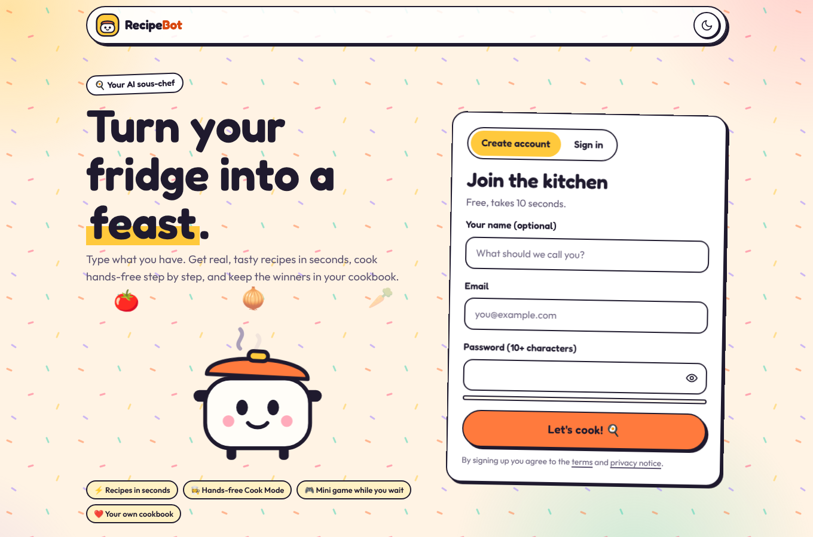
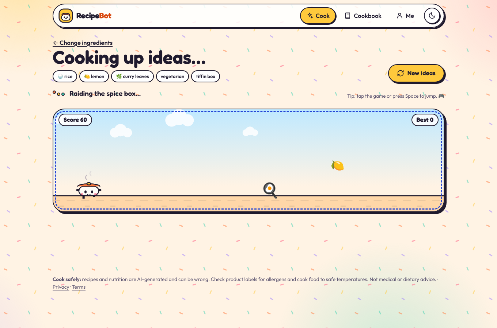
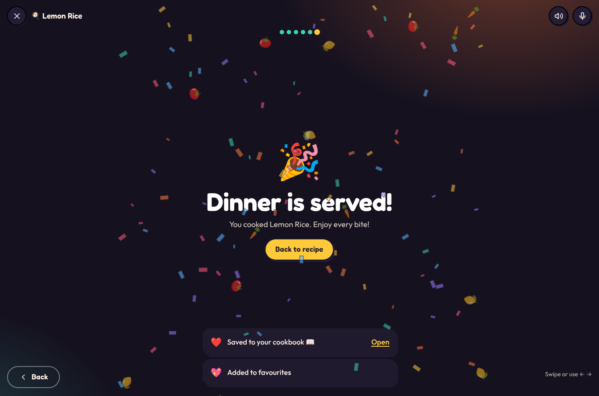
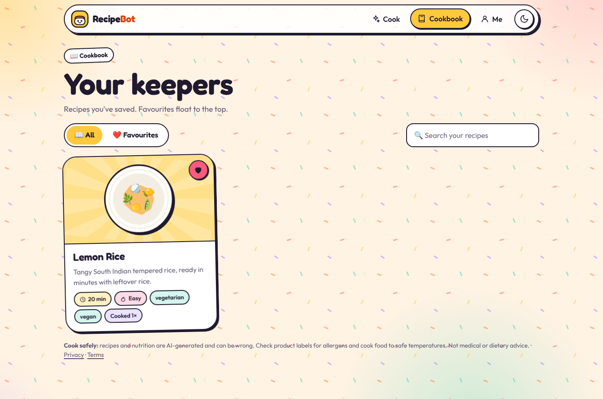
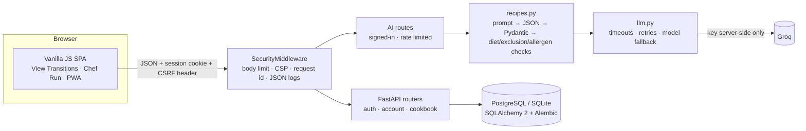

# Recipe Bot 🍲

**Turn your fridge into a feast.** Type the ingredients you have and Recipe Bot's AI sous-chef (Groq, gpt-oss-120b) gives you real, tasty recipes built around them. While it thinks, you play **Chef Run**, a tiny runner game. Then you can cook hands-free step by step and keep the winners in your cookbook.

> **Status:** launch candidate. 138 backend tests pass on SQLite and PostgreSQL 16. Browser journeys pass on mobile and desktop in light and dark mode with no console errors, and axe-core finds 0 accessibility violations on 20 screens. **Not yet deployed**, and **the live Groq API has not been called from the build environment**, so do the first real-key smoke test yourself (see [Known limitations](#known-limitations)).

| Sign in first | Chef Run while the AI thinks | Your recipes |
|---|---|---|
|  |  |  |
| **Recipe page (dark)** | **Cook Mode** | **Cookbook** |
|  |  |  |

*Screenshots use the built-in demo provider (`scripts/run_mock_server.py`), so the recipes are sample data.*

## Features

| | |
|---|---|
| 🔐 **Sign in first** | A playful landing page with an animated mascot. You create an account or sign in before entering the app, and you return to the page you asked for. |
| 🧺 **Cook with what you have** | Type ingredients as chips (or speak them), tap common staples, pick a mood (quick weeknight, tiffin box, comfort food…), and optionally set cuisine, diet, time, spice, difficulty, servings and "never include". |
| 🤖 **Real recipes, not canned ones** | The model is told to suggest real, well-known dishes built around *your* ingredients, with at most three extras, realistic quantities and steps with heat, time and doneness cues. Every card shows **"Uses N of yours"** and what you'd need to buy. The best match gets a ⭐. |
| 🎮 **Chef Run** | A Chrome-dino-style runner starring the pot-bot. Jump over 🔥🔪🍳 and grab ingredients for bonus points. It plays while the AI cooks up ideas. If you're mid-run when recipes arrive, a "Your recipes are ready!" button pops up so you're never cut off. Your best score is saved to your account. |
| 👩‍🍳 **Hands-free Cook Mode** | Full-screen steps with big type. Use swipe, the arrow keys or voice ("next", "back", "repeat") to move between steps. It can read steps aloud, keeps the screen awake, and turns "simmer 10 minutes" into a tap-to-start timer. The last step ends with confetti. |
| ❤️ **Cookbook** | Save, favourite, search, add notes and track how often you've cooked each recipe. Remix any recipe (spicier, healthier, quicker, kid-friendly, vegan), swap ingredients, scale servings and print. |
| ✨ **Feels like an app** | A "juicy sticker" look (Fredoka + Outfit), view-transition morphs, a confetti reveal, light and dark themes, and an installable PWA. It respects reduced-motion settings. |

## Safety by design

- AI output is **parsed as JSON and validated** server-side. Malformed responses are retried once, and anything still invalid is rejected, never shown.
- Recipes containing an **excluded ingredient** or clearly breaking a **chosen diet** are dropped.
- Allergens are **detected from ingredient names** and always shown as "may contain, check labels". Nutrition is labelled as an AI estimate.
- Every page carries food-safety guidance. Recipe Bot is not medical or dietary advice.

## Run it locally

**Prerequisites:** Python 3.11+ and a free Groq API key from [console.groq.com/keys](https://console.groq.com/keys).

Windows (PowerShell or Command Prompt), from the project folder:

```bat
python -m venv .venv
.venv\Scripts\python -m pip install -r requirements.txt
copy .env.example .env
notepad .env
```

In Notepad, set `GROQ_API_KEY=gsk_...` and save. Then:

```bat
.venv\Scripts\python scripts\check_ai.py
.venv\Scripts\python -m uvicorn main:app --reload --port 8080
```

Then open http://127.0.0.1:8080. If you see `WinError 10013`, that port is blocked or already in use on your PC, so try another one (`--port 5050`).

`check_ai.py` confirms the key works (it never prints the key) and shows the provider's error message if it doesn't. `HTTP 404` means the model isn't available to your key: set `AI_MODEL` in `.env`.

macOS / Linux:

```bash
python3 -m venv .venv && source .venv/bin/activate
pip install -r requirements.txt
cp .env.example .env            # set GROQ_API_KEY=gsk_...
python scripts/check_ai.py
uvicorn main:app --reload
```

On macOS/Linux, open http://127.0.0.1:8000. Locally the app uses a SQLite file and applies migrations on startup.

**No key yet?** `python scripts/run_mock_server.py` runs the whole app with a small set of canned sample recipes. A banner says you're in demo mode, and the same few recipes repeat. That's expected; real variety needs a key.

### Environment variables

All are documented in [`.env.example`](.env.example). Never commit a real `.env`.

| Variable | Default | Description |
|---|---|---|
| `GROQ_API_KEY` | — | **Secret**, server-side only. Without it, recipe generation shows a "not configured" message |
| `AI_PROVIDER` | `groq` | `groq`, `gemini` or `openrouter`. Setting `GEMINI_API_KEY` or `OPENROUTER_API_KEY` instead also works |
| `AI_MODEL` / `AI_FALLBACK_MODELS` | `openai/gpt-oss-120b` / — | Primary model and comma-separated fallbacks (e.g. `openai/gpt-oss-20b`) |
| `AI_TIMEOUT_SECONDS` / `AI_MAX_RETRIES` | `45` / `2` | Provider timeout and bounded retries |
| `DATABASE_URL` | local SQLite file | PostgreSQL in production (`postgres://` and `postgresql://` both work) |
| `APP_ENV` | `development` | `production` enables secure `__Host-` cookies and HSTS, hides `/docs`, and turns off auto-migrate |
| `AI_RATE_LIMIT_PER_MINUTE` / `LOGIN_RATE_LIMIT_PER_MINUTE` | `8` / `8` | AI limit applies per user and per IP |
| `SESSION_DAYS`, `MAX_REQUEST_BYTES`, `ALLOWED_ORIGINS`, `TRUST_PROXY`, `APP_PUBLIC_URL`, `APP_TITLE`, `LOG_LEVEL` | | See `.env.example` |

## Launch it (Render)

[`render.yaml`](render.yaml) is a Render Blueprint: a Python web service plus a managed PostgreSQL 16 database. It deploys from `main` **only after GitHub checks pass** (`autoDeployTrigger: checksPass`) and runs `alembic upgrade head` before starting.

1. Push this code to `main` on GitHub (CI runs automatically).
2. On [render.com](https://render.com) choose **New → Blueprint** and pick the repository.
3. When prompted, paste your `GROQ_API_KEY` (and optionally `APP_PUBLIC_URL`). Secrets live only in Render.
4. Open `https://<your-app>.onrender.com/readyz`. It should return `{"status":"ready"}`. Then sign up and cook something.

- **Logs:** JSON lines with request id, path, status and latency. They never include prompts, recipe text, emails or keys.
- **Backups:** use a paid Render Postgres plan for daily backups and point-in-time recovery.
- **Rollback:** in Render, open **Events** and choose **Rollback** on the last good deploy, or `git revert` on `main`.
- **Groq free tier:** it has per-minute and per-day limits. The app returns a friendly "kitchen is busy" message when they're hit. Upgrade the Groq plan before heavy traffic.

## Architecture



| Path | Purpose |
|---|---|
| `app/main.py` | App factory, AI routes, app-shell routing |
| `app/routers/` | `account` (auth, profile, game score, password, export, delete), `cookbook` |
| `app/auth.py` | argon2id hashing, hashed server-side sessions, CSRF, Origin check |
| `app/models.py`, `migrations/` | `users`, `sessions`, `saved_recipes`, plus Alembic migrations |
| `app/recipes.py`, `app/llm.py`, `app/schemas.py` | Prompting, validation, safety rules, OpenAI-compatible client |
| `static/` | Frontend, no build step: `js/views/*`, `js/lib/*` (incl. `chefrun.js`), `css/`, fonts, PWA |
| `tests/`, `e2e/` | pytest suite with a fake provider; Playwright journeys and axe-core scan |
| `scripts/` | `run_mock_server.py` (demo mode), `check_ai.py` (key check) |

**API:** `POST /api/recipes/generate` · `POST /api/recipes/substitute` · `GET /api/options` · `POST /api/auth/signup|login|logout` · `GET /api/auth/me` · `PUT /api/account/profile` · `POST /api/account/game-score` · `POST /api/account/password` · `GET /api/account/export` · `DELETE /api/account` · `GET/POST /api/recipes` · `GET/PATCH/DELETE /api/recipes/{id}` · `POST /api/recipes/{id}/cooked` · `GET /healthz` · `GET /readyz`.

## Tests

```bash
pip install -r requirements-dev.txt
pytest                                   # 138 tests, SQLite in-memory, AI mocked, network blocked
TEST_DATABASE_URL=postgresql://user@localhost/recipebot_test pytest
ruff check . && ruff format --check .
pip-audit -r requirements.txt
```

The suite covers signup and login (no account enumeration), sessions, CSRF and Origin checks, throttling, cross-user isolation, password change, export, account deletion, prompt content, coverage ranking, diet and exclusion filtering, malformed model output, retries, timeouts, fallback, rate limits, game scores, and migrations matching the models.

The browser checks in `e2e/` are described in [e2e/README.md](e2e/README.md). CI (`.github/workflows/ci.yml`) runs all of the above on every push.

## Security and privacy

- **Secrets:** the AI key is server-side only. It is never sent to the browser, logged, or put in errors.
- **Passwords:** hashed with argon2id.
- **Sessions:** an HttpOnly, SameSite=Lax cookie (`__Host-` and Secure in production). Only a hash of the token is stored.
- **CSRF:** a synchronizer token plus an Origin check on every change.
- **Rendering:** the UI never parses HTML strings, and a strict CSP is applied (`script-src 'self'`).
- **Your data:** you can export it or delete your account. The privacy notice and terms are at `/privacy` and `/terms` (drafts, to be reviewed before a public launch).
- ⚠️ **Earlier versions of this repository committed two OpenRouter API keys.** They remain in Git history and **must be revoked** on openrouter.ai. See [`docs/AUDIT.md` §7](docs/AUDIT.md#7-credential-remediation-action-required-by-the-repo-owner).

## Known limitations

- **Live Groq calls are untested from the build environment** (its network can't reach Groq). Every AI path is tested with a mocked provider. Run `python scripts/check_ai.py`, then generate a few recipes, before sharing the link.
- **Keyword-based safety checks** catch obvious diet, exclusion and allergen problems, but not hidden ingredients in branded products.
- **Single instance:** rate limiting is in memory, so add Redis before scaling out. There is no password-reset email yet.
- **Browser support varies:** voice, read-aloud and wake lock degrade gracefully where unsupported.

## License

No license has been chosen yet; until the owner adds one, all rights are reserved. Fonts: Fredoka and Outfit are under the SIL Open Font License (see `static/fonts/`).
